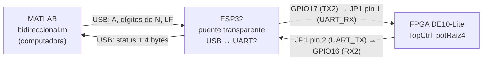
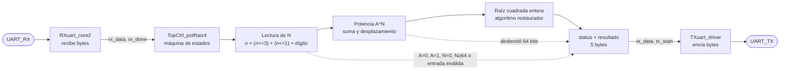
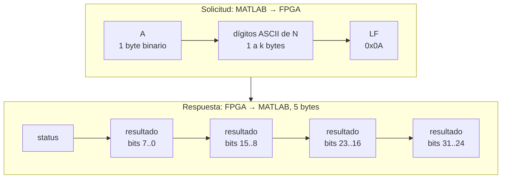
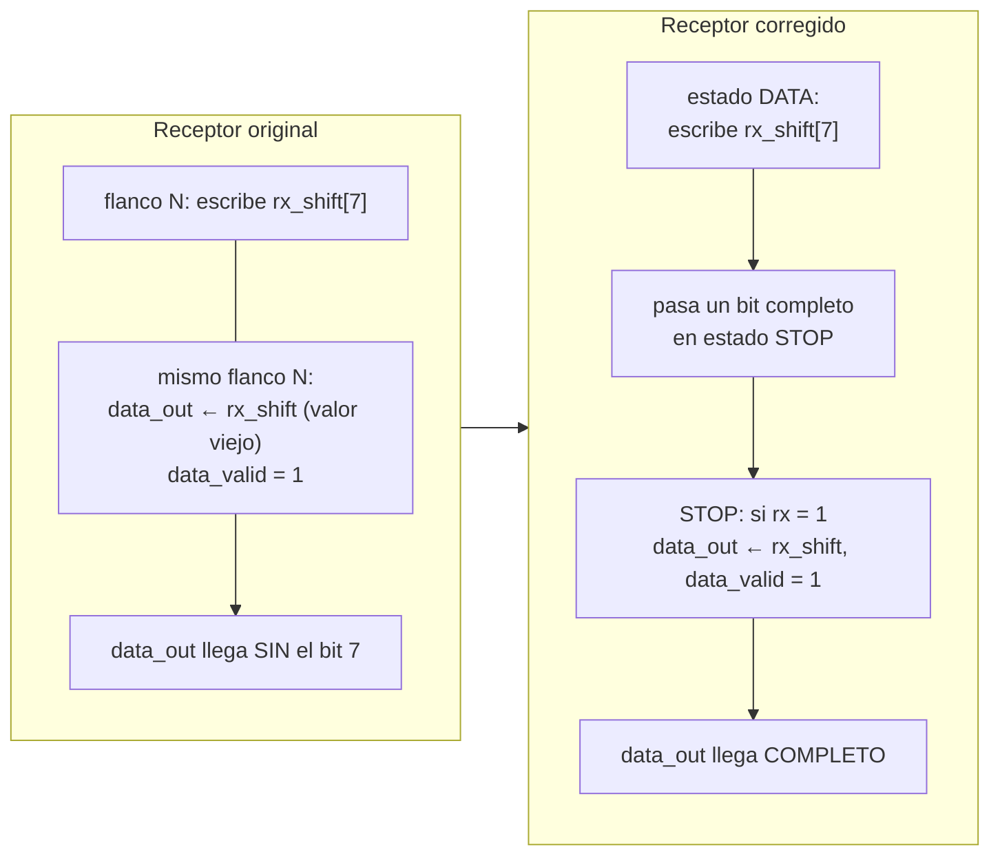
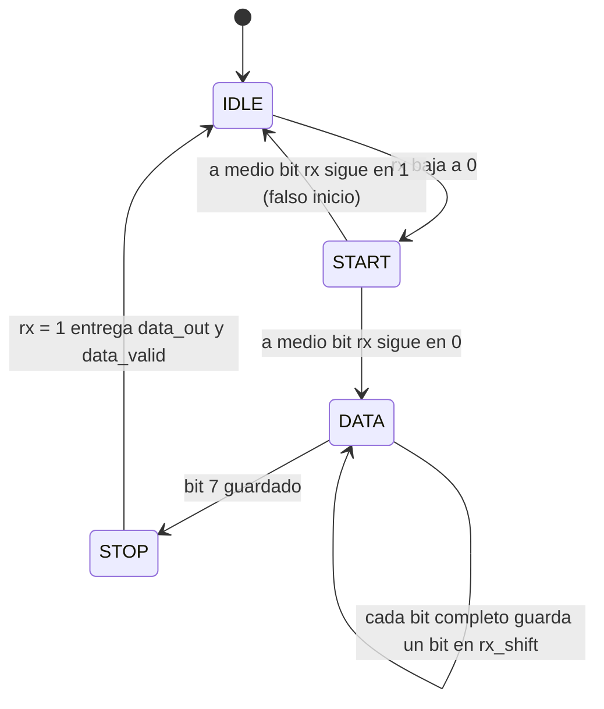
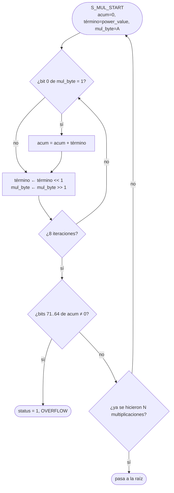
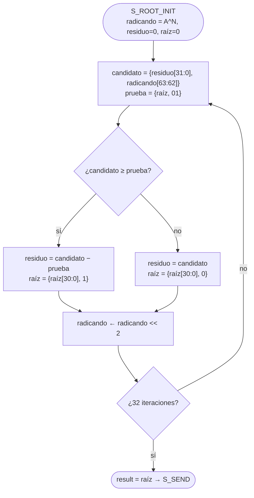
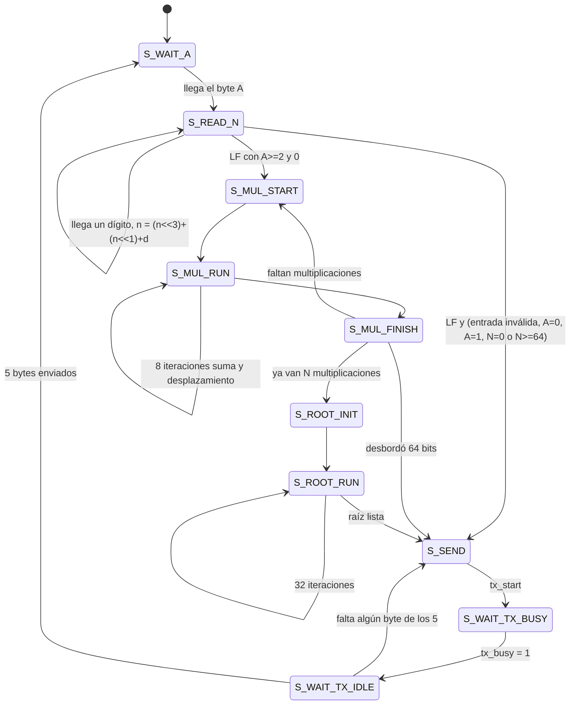

# Práctica 4: UART bidireccional entre FPGA DE10-Lite, ESP32 y MATLAB, con cálculo estructural de A^(N/2) sin división

MATLAB manda a la FPGA una base `A` (1 byte) y un exponente `N` (texto decimal de cualquier longitud). La FPGA calcula `floor(A^(N/2))`, o sea la raíz cuadrada entera de `A^N`, y regresa el resultado. En ningún punto del cálculo se usa el operador de división: todo se resuelve con sumas, restas, comparaciones y desplazamientos.

## 1. Vista general del sistema

El ESP32 no calcula nada. Solo pasa bytes de un lado a otro entre el USB de la computadora y la UART de la FPGA.



Conexión física (primero se desconectan los dos USB, después se cablea):

| Señal | ESP32 | DE10-Lite (JP1) |
|---|---|---|
| ESP32 transmite, FPGA recibe | GPIO17 (TX2) | pin 1, `UART_RX`, PIN_V10 |
| FPGA transmite, ESP32 recibe | GPIO16 (RX2) | pin 2, `UART_TX`, PIN_W10 |
| Tierra común | GND | pin 12, GND |

El pin 11 (5 V) no se conecta. Cada tarjeta se alimenta por su propio USB y las dos trabajan a 3.3 V.

## 2. Qué hay dentro de la FPGA



## 3. Protocolo



Ejemplo, `A=4`, `N=10`: MATLAB envía `04 31 30 0A` y la FPGA responde `00 00 04 00 00` (1024 en little-endian).

| status | significado |
|---|---|
| 0 | resultado válido, cabe en 32 bits |
| 1 | OVERFLOW, `A^(N/2)` no cabe en 32 bits |
| 2 | entrada inválida: `N` vacío o con caracteres que no son dígitos |

Trama UART de cada byte (9600 baudios, 8N1, `CLKS_PER_BIT = 50 000 000 / 9600 ≈ 5208`):

```
 línea  ‾‾‾‾‾|_____|_b0_|_b1_|_b2_|_b3_|_b4_|_b5_|_b6_|_b7_|‾‾‾‾‾‾‾‾
              inicio   ←── 8 bits de datos, LSB primero ──→  paro
```

## 4. El bug del receptor original y cómo se corrigió

La versión del profesor escribía el bit 7 en `rx_shift` y copiaba `rx_shift` a `data_out` en el mismo flanco de reloj. Como las asignaciones son no bloqueantes, `data_out` agarraba el valor viejo de `rx_shift`, sin el bit 7. Además muestreaba demasiado pronto y confundía el bit de inicio con el primer dato.



Máquina de estados del receptor corregido:



Resumen de tiempos: el inicio se verifica a medio bit, el primer dato se lee a bit y medio desde el flanco de bajada, y el byte solo se acepta si el bit de paro vale 1.

## 5. Puntos extra: A^(N/2) sin división

### 5.1 Lectura de N con desplazamientos

Cada dígito ASCII nuevo se acumula con `n = 10·n + d`. Como `10n = 8n + 2n`, se escribe con desplazamientos y no se usa multiplicación:

```verilog
n_sat <= (n_sat << 3) + (n_sat << 1) + (rx_data - 8'd48);
```

Así se acepta cualquier cantidad de dígitos. El registro solo guarda de 0 a 64 y se satura en cuanto un dígito nuevo lo haría pasar de 63, porque con `A ≥ 2` cualquier `N ≥ 64` desborda 32 bits de todas formas.

Ejemplo con `N = "10"`:

| Carácter | Operación | `n_sat` |
|---|---|---|
| inicial | | 0 |
| `'1'` | (0<<3) + (0<<1) + 1 | 1 |
| `'0'` | (1<<3) + (1<<1) + 0 = 8 + 2 | 10 |
| `LF` | termina la lectura | 10 |

### 5.2 Potencia por suma y desplazamiento

`A^N` se obtiene multiplicando un acumulador de 64 bits por `A`, `N` veces. Cada multiplicación recorre los 8 bits de `A`: si el bit vale 1 suma el multiplicando, y en cada vuelta el multiplicando se desplaza a la izquierda.



El acumulador es de 72 bits a propósito: los 8 bits extra permiten detectar si el producto ya no cabe en 64 bits sin perder información.

### 5.3 Raíz cuadrada entera sin dividir

Algoritmo restaurador de 32 iteraciones. En cada una entran dos bits del radicando al residuo, se compara contra `{raíz, 01}` y se decide si se resta o se conserva el residuo. Cada comparación aporta un bit de la raíz.



### 5.4 Ejemplo completo: A = 4, N = 7

1. `'7'` llega por UART y `n_sat = 7`.
2. `4^7 = 16384`, calculado con 7 pasadas de suma y desplazamiento.
3. La raíz restauradora entrega `sqrt(16384) = 128`.
4. La FPGA responde `00 80 00 00 00`.

### 5.5 Máquina de estados principal



La única división del proyecto es `CLK_FREQ / BAUD_RATE`. Es una constante que se calcula al sintetizar, no una operación que haga la FPGA mientras corre.

## 6. Estructura del repositorio

```
serial/
├── serial.qpf / serial.qsf / serial.sdc    proyecto Quartus y pines (CLK, JP1)
├── top_uart_de10lite.v   (módulo TopCtrl_potRaiz4)   lectura de A y N, potencia, raíz, control UART
├── uart_rx.v             (módulo RXuart_core2)       receptor corregido
├── uart_tx.v             (módulo TXuart_driver)      transmisor 8N1
├── arduino/sketch_oct22a/sketch_oct22a.ino           puente del ESP32
├── matlab/bidireccional.m                            interfaz en MATLAB
├── tb/tb_serial.v                                    banco de pruebas
└── checks/verificar_matematica.py                    verificación del modelo matemático
```

## 7. Cómo ejecutarlo

1. Descomprimir en una carpeta limpia, sin mezclar con versiones anteriores.
2. Quartus: abrir `serial/serial.qpf` y compilar (`Processing > Start Compilation`).
3. `Tools > Programmer`, agregar `serial/output_files/serial.sof`, marcar `Program/Configure` y pulsar `Start` hasta 100 %.
4. Arduino IDE: cargar `sketch_oct22a.ino` en `ESP32 Dev Module` (Serial2 en GPIO16/17, 9600). Cerrar el Monitor Serial.
5. MATLAB: ejecutar `serial/matlab/bidireccional.m` con `PORT` igual al COM del ESP32.

## 8. Pruebas

| A | N | A^N | floor(A^(N/2)) | Estado |
|---|---|---|---|---|
| 4 | 7 | 16 384 | 128 | OK |
| 4 | 10 | 1 048 576 | 1024 | OK |
| 2 | 40 | 2^40 | 1 048 576 | OK |
| 2 | 63 | 2^63 | 3 037 000 499 | OK |
| 2 | 64 | 2^64 | n/a | OVERFLOW |
| 255 | 8 | 255^8 | 4 228 250 625 | OK |
| 255 | 9 | 255^9 | n/a | OVERFLOW |
| 1 | 999999999999 | 1 | 1 | OK |
| 0 | 999999999999 | 0 | 0 | OK |
| 0 | 0 | 1 (convención) | 1 | OK |
| 9 | 7 | 4 782 969 | 2187 | OK |

`tb/tb_serial.v` repite estos casos en simulación con reloj de 10 MHz y 1 Mbaud para que corra rápido.

## Autores

- Rodrigo Daniel Carretero Santamaría, id. 180293
- Victor Hugo De La Calleja Mojica, id. 181626

Universidad de las Américas Puebla (UDLAP), Laboratorio de Sistemas Embebidos.
